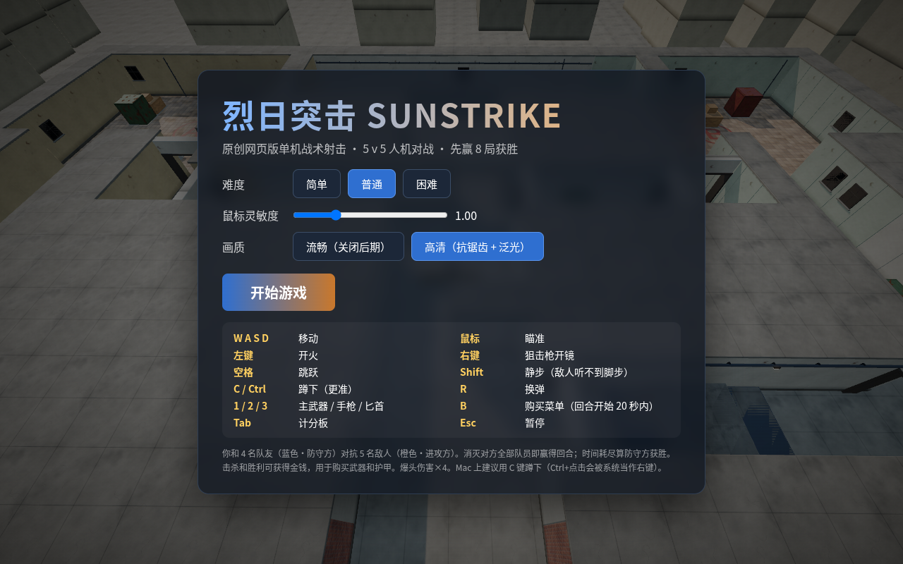
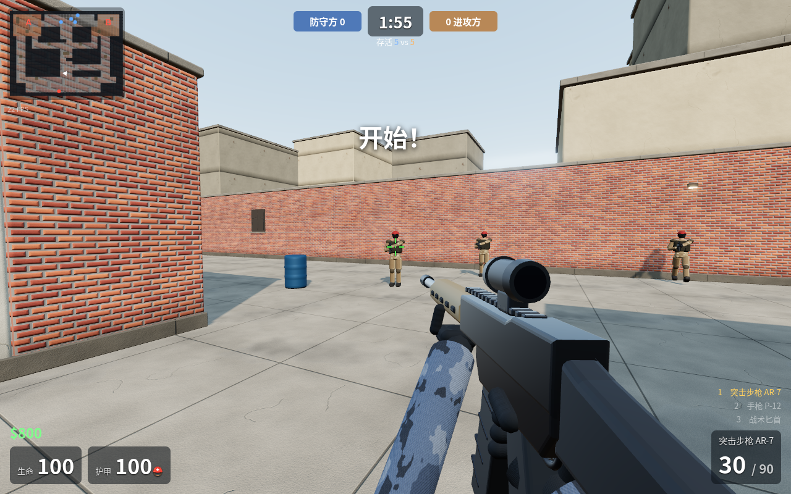
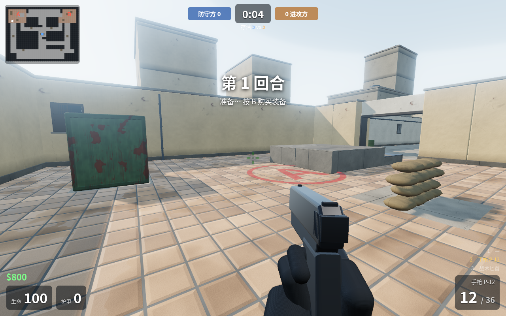
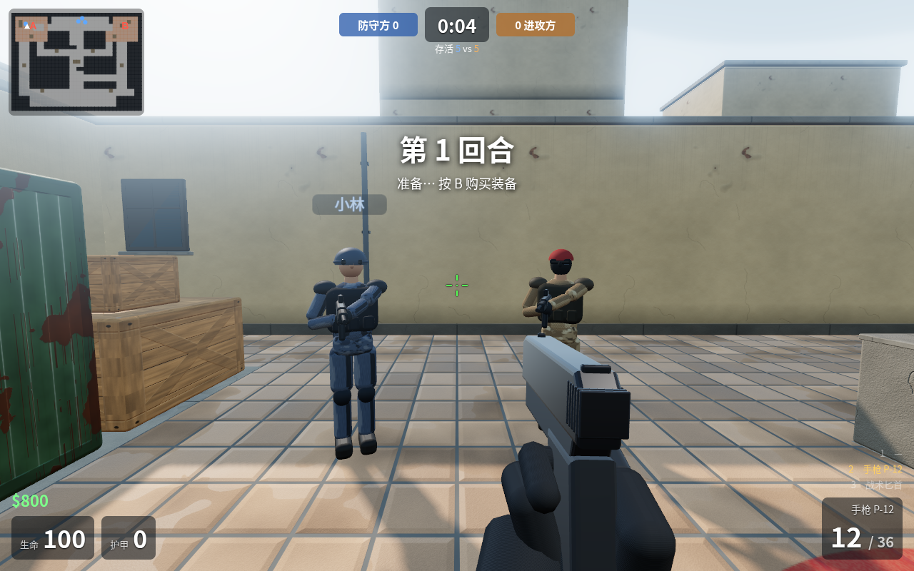
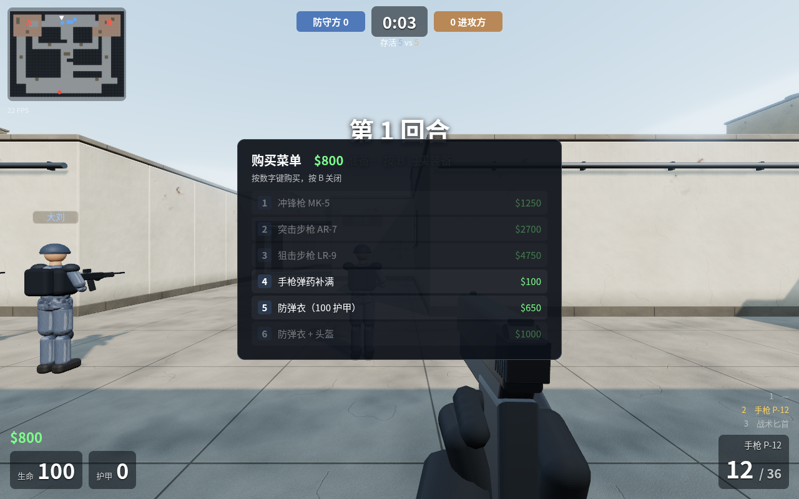

# 烈日突击 SUNSTRIKE

一款**原创**的网页版单机战术射击游戏（5 v 5 人机对战），纯浏览器运行、单个 HTML 文件、无需安装。
所有地图、模型、材质、音效均为程序化生成的原创内容，不包含任何第三方游戏的素材、名称或地图。

**▶ 在线试玩：https://joyhsin.github.io/sunstrike/**



## 截图

| 实战 | 材质细节 |
|---|---|
|  |  |
| **角色模型** | **第一人称武器** |
|  |  |



## 玩法介绍

- 你和 4 名 AI 队友（蓝色 · 防守方）对抗 5 名 AI 敌人（橙色 · 进攻方）。
- 消灭对方全部队员即赢得回合；回合时间耗尽算防守方获胜；**先赢 8 局**的一方赢得比赛。
- 击杀与胜负都会获得金钱，回合开始 20 秒内可按 **B** 打开购买菜单购买武器和护甲。
- 爆头伤害 ×4，护甲可减免身体伤害，头盔可减免爆头伤害。
- 难度可选：**简单 / 普通 / 困难**（影响 AI 反应速度、瞄准精度、爆头率和听觉范围）。

### 武器

| 武器 | 说明 |
|---|---|
| 突击步枪 AR-7 | 全自动，伤害高，后坐力明显（$2700） |
| 冲锋枪 MK-5 | 射速快、移动射击更稳，击杀奖励高（$1250） |
| 狙击步枪 LR-9 | 右键开镜（两级倍率），一枪致命（$4750） |
| 手枪 P-12 | 默认副武器 |
| 战术匕首 | 近战，背刺伤害极高 |

## 操作说明

| 按键 | 功能 |
|---|---|
| W A S D | 移动 |
| 鼠标 | 瞄准 |
| 左键 | 开火 |
| 右键 | 狙击枪开镜 |
| 空格 | 跳跃 |
| Shift | 静步（敌人听不到脚步声） |
| C / Ctrl | 蹲下（射击更准）。Mac 上建议用 C（Ctrl+点击会被系统当作右键） |
| R | 换弹 |
| 1 / 2 / 3 | 主武器 / 手枪 / 匕首（Q 快速切换） |
| B | 购买菜单（数字键 1–6 购买） |
| Tab | 计分板 |
| Esc | 暂停 |

## 画面与技术

- 基于 [three.js](https://threejs.org/) r170，打包成**单个自包含的 `index.html`**（离线可玩，双击即可打开）。
- PBR 材质（MeshStandardMaterial），程序化生成 1024×1024 的颜色 / 法线 / 粗糙度贴图：混凝土地面、石砖地面、灰泥墙、红砖墙、木箱、锈蚀集装箱等；世界坐标 UV，贴图不拉伸；三线性过滤 + 各向异性过滤。
- 物理天空（Sky）+ PMREM 环境光照、ACES 电影色调映射、4096 软阴影、雾效、接触阴影（AO）。
- 圆角几何体、墙顶压檐、踢脚线、门框、窗户、管道、壁灯、沙袋、油桶、远景建筑。
- 角色由胶囊体 / 车削体等平滑几何组成，带头盔/护目镜、战术背心、护膝、背包，以及行走与持枪姿态（IK）。
- 第一人称武器为多部件精细建模（挤出轮廓 + 倒角、金属度/粗糙度材质），配手套与袖子。
- 粒子：烟雾、火花、血雾、柔边弹孔贴花；枪口火焰配合泛光（Bloom）。
- 画质选项：**高清**（最高 2 倍像素比、4 倍 MSAA、泛光）/ **流畅**（1 倍像素比、关闭后期处理）。

## 本地运行

直接下载仓库里的 `index.html`，用 Chrome / Safari / Edge 双击打开即可（无需服务器、无需联网）。

## 自行构建

```bash
npm install        # 安装 three.js 与 esbuild
npm run build      # 生成 index.html
```

源码结构：

```
src/
  template.html        页面结构、HUD 与菜单样式
  build.js             构建脚本：拼接 parts → esbuild 打包 → 内联到 index.html
  parts/
    00-imports.js      three.js 及扩展模块引入
    10-core.js         地图、渲染器、天空/光照、程序化材质、场景搭建、碰撞与寻路
    20-audio-weapons.js WebAudio 程序化音效、武器参数、购买列表
    25-models-fx.js    角色模型、第一人称武器、粒子特效
    30-gameplay.js     玩家控制、AI 机器人、伤害、回合与经济系统
    40-hud-loop.js     HUD、输入、后期处理与主循环
```

## 许可证

[MIT](LICENSE)
